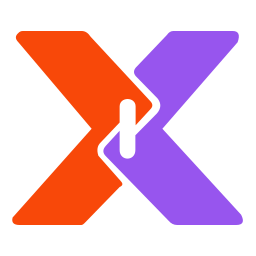
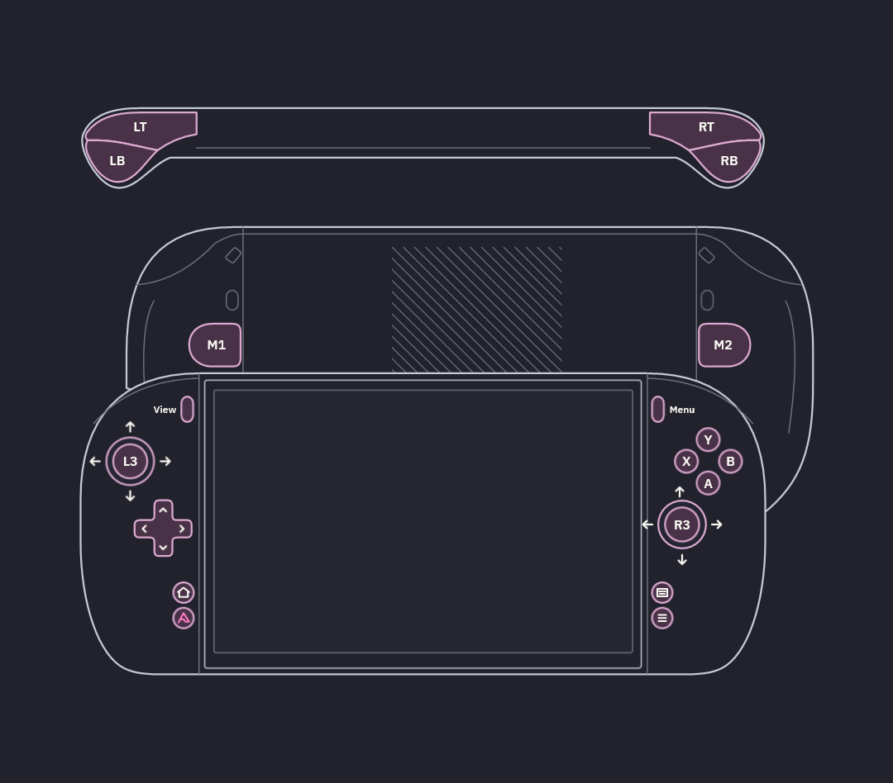
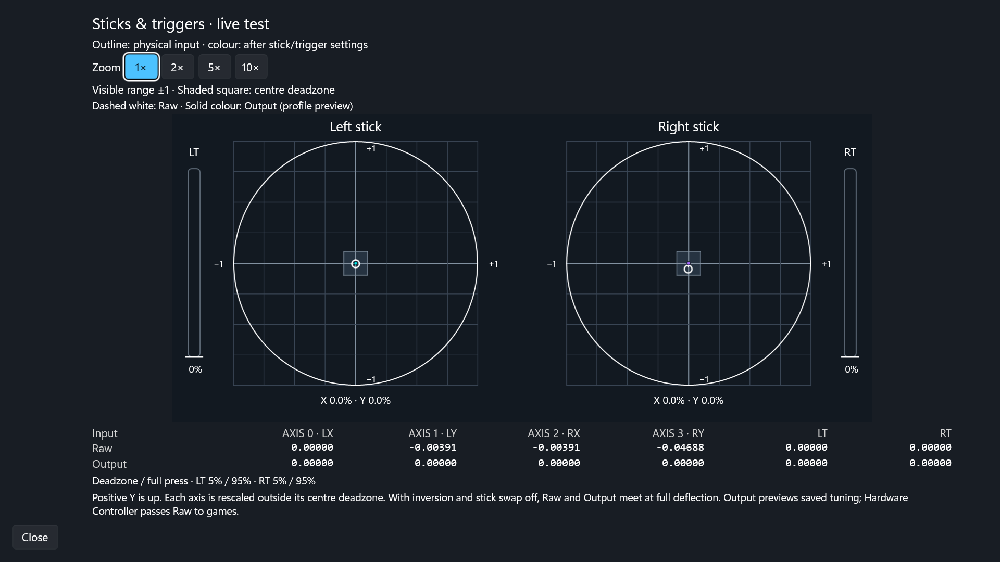
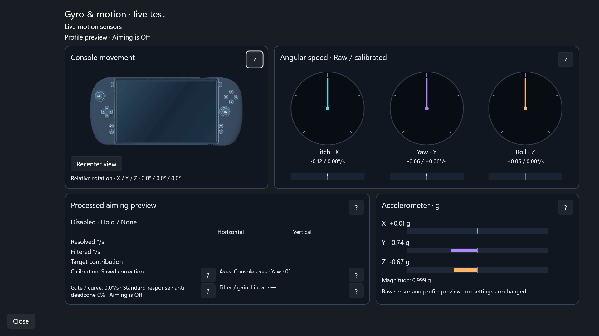
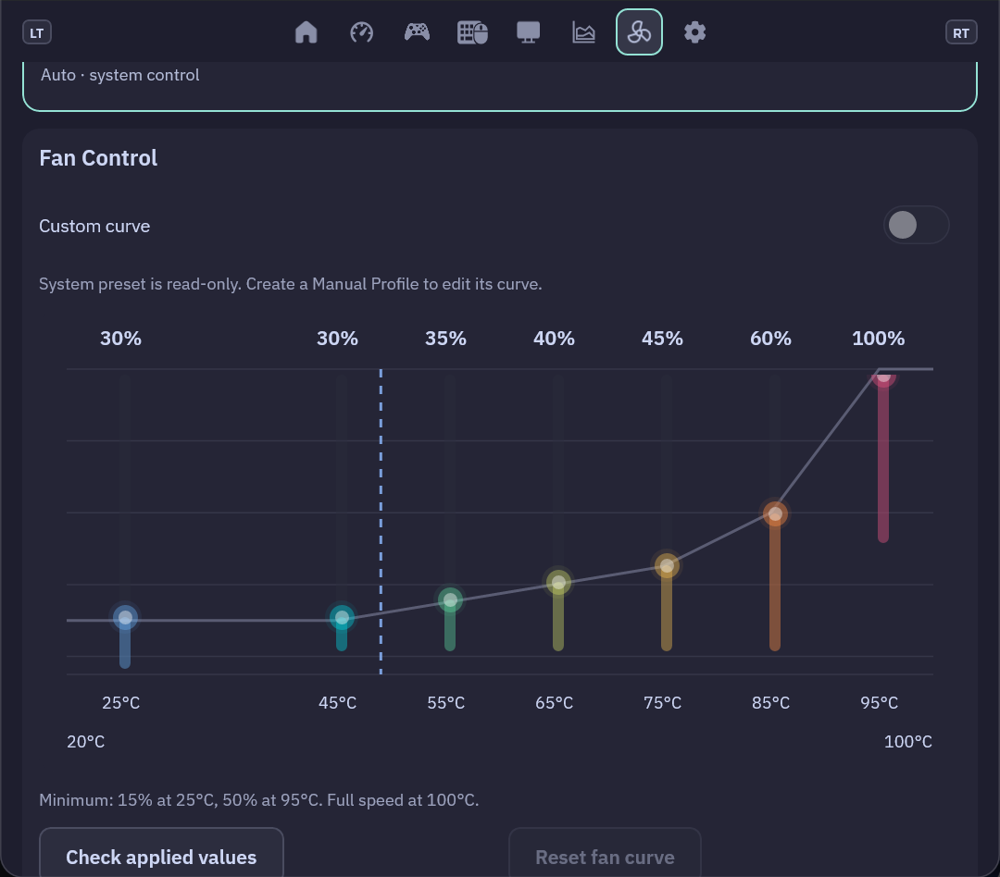
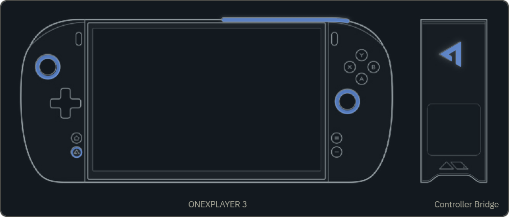

<p align="center">
  
</p>

<h1 align="center">ONEXTweaks</h1>

<p align="center"><strong>Настройки ONEXPLAYER 3 поверх игры, прямо в Xbox Game Bar.</strong><br>
Мощность, охлаждение, управление и экран в одном виджете.</p>

<p align="center">
  <a href="#возможности">Возможности</a> ·
  <a href="#установка">Установка</a> ·
  <a href="#зависимости">Зависимости</a> ·
  <a href="#удаление">Удаление</a> ·
  <a href="#поддержать-проект">Поддержать проект</a>
</p>

<p align="center">
  
</p>

**Для кого.** Виджет рассчитан на ONEXPLAYER 3 с Intel и Windows 11 x64. Аппаратное управление через PowerAgent включается после проверки платы `1002-B`, BIOS `5.01` и совместимых компонентов OneXConsole.

## Возможности

### 🏠 Главное

Следите за загрузкой CPU и GPU, температурой, мощностью и зарядом в реальном времени. Меняйте яркость, громкость и лимиты мощности поверх игры. Быстрые плитки открывают управление Wi‑Fi и Bluetooth, микшер и выбор аудиовыхода, клавиатуру Windows, профили и режим питания. Плитки можно перемещать, скрывать и дополнять своими сочетаниями клавиш, приложениями и ссылками. Есть быстрые действия для Steam, управления музыкой и переключения окон.

### ⚡ Производительность

Настраивайте PL1 и PL2, режим питания Windows, CPU Boost и предпочтение производительных или энергоэффективных ядер. Сохраняйте отдельные настройки от сети (**AC**) и от батареи (**DC**). Профили можно выбирать вручную или привязывать к запущенной игре. В настройках FPS доступен выбор между RTSS и Intel. Доступность Intel зависит от драйвера и игры.


### 🎮 Геймпад

- Переключайтесь между физическим контроллером (**Hardware**) и виртуальными **Xbox 360** или **DualShock 4** на VIIPER.
- Переназначайте кнопки и дополнительные клавиши корпуса. На интерактивной схеме можно выбрать кнопку геймпада, клавишу, действие мыши или комбинацию. Для DualShock 4 доступны отдельные назначения на левый и правый клик тачпада.
- Настраивайте мёртвые зоны, ход триггеров и вибрацию в поддерживаемых режимах. Окно **Test sticks & triggers** показывает исходные и обработанные значения по осям. Чтобы применить программную обработку стиков и триггеров к игре, выберите виртуальный контроллер.
- Калибруйте гироскоп и направляйте его в стик или мышь. Тест показывает движение 3D-модели, угловую скорость и данные акселерометра. Виртуальный DS4 отдельно умеет передавать данные датчиков совместимым играм.

<details>
<summary>Скриншоты DualShock 4, теста стиков и гироскопа</summary>






</details>

### ⌨️ Клавиатура и мышь

Используйте стики как курсор и прокрутку, меняйте скорость и точность мыши. Назначайте клики, сочетания клавиш и последовательности с задержками. Основное действие и **Fn-слой** настраиваются в одном редакторе кнопки.


### 🖥️ Экран

Переключайте разрешение и частоту обновления, блокируйте поворот, настраивайте яркость и профили цвета. В профилях можно сохранить насыщенность, оттенок, контраст и гамму. HDR, VRR, масштабирование и функции графики Intel доступны в зависимости от экрана, режима и драйвера. Плитка **OptiScaler** открывает меню OptiScaler в играх, где он уже установлен.

### 📊 Оверлей

Показывайте FPS, время кадра, температуры, загрузку и мощность в игре через RTSS. Можно выбрать готовый пресет или настроить метрики, размер, шрифт и фон под себя.

### 🌬️ Вентилятор

Оставьте системный **Auto** или настройте свою кривую по температурным точкам. Профили вентилятора можно назначать играм отдельно от профилей производительности. Обороты видны в виджете при доступном аппаратном канале.

<details>
<summary>Скриншот редактора кривой</summary>



</details>

### 💡 Подсветка

Меняйте цвет, яркость и эффекты подсветки консоли. Схема показывает управляемые зоны, включая кольца стиков и совместимый Controller Bridge.

<details>
<summary>Скриншот зон подсветки</summary>



</details>

### ⚙️ Система и оформление

Задавайте лимит заряда и временно удерживайте консоль активной с таймером и затемнением. Настраивайте автозапуск, порядок и видимость вкладок, язык и тему. В комплекте есть светлые, тёмные и OLED-палитры, в том числе Dracula, Catppuccin и Kanagawa. Виджетом можно управлять геймпадом, касанием или мышью. Закрепить его поверх игры можно штатной кнопкой Game Bar.

## Установка

> [!NOTE]
> Первый публичный установщик готовится. Ссылка на скачивание появится в [GitHub Releases](https://github.com/KiryaChainik/ONEXTweaks/releases).

1. Убедитесь, что **Xbox Game Bar** открывается по **Win + G**. При необходимости установите его из Microsoft Store. Для аппаратных функций оставьте установленной совместимую **OneXConsole**. [Xbox Game Bar](https://apps.microsoft.com/detail/9NZKPSTSNW4P) · [Драйверы и ПО ONEXPLAYER](https://onexplayerstore.com/pages/drivers-and-faqs)
2. Скачайте `ONEXTweaks-Setup-x64.exe` из релиза и сверьте его SHA‑256 со значением на странице релиза. Запустите Setup из своего обычного аккаунта Windows, нажмите **Install** и подтвердите запросы Windows по ходу установки.
3. Если Setup запросит перезагрузку, перезагрузитесь, войдите в тот же аккаунт и снова запустите тот же EXE. После завершения откройте **Win + G → Виджеты → ONEXTweaks**.

**Что важно знать**

- После проверки аппаратного канала Setup отключает штатный автозапуск **интерфейса** OneXConsole, если он был включён. Её аппаратные компоненты остаются доступны. При необходимости интерфейс можно открыть вручную.
- Для бета-сборки при первой установке Setup может запросить доверие к сертификату виджета. Сверьте издателя и отпечаток с конкретным релизом. Windows также может показать предупреждение SmartScreen.
- Тестовый режим Windows и обход проверки подписи для штатной установки не требуются. Подробности о сертификате, подготовке пакетов и обновлении с 1109 на 1110 есть в [документации установщика](tools/installer/README.md).

## Зависимости

**Подготовьте перед установкой**

- **Windows 11 x64 и Xbox Game Bar** — платформа и меню виджетов. Game Bar ставится через Microsoft Store. [Xbox Game Bar](https://apps.microsoft.com/detail/9NZKPSTSNW4P)
- **OneXConsole** — предоставляет PowerAgent аппаратные компоненты для вентилятора, мощности, зарядки и других функций консоли. Проверенный комплект относится к OneXConsole **0.10.4-fix3**. Для обычной установки используйте совместимую копию от производителя. Setup также принимает отдельно предоставленный OEM-установщик после проверки подписи и контрольной суммы. [ПО производителя](https://onexplayerstore.com/pages/drivers-and-faqs)

**Setup скачивает и ставит недостающие компоненты**

- **PawnIO 2.2.0** — аппаратная телеметрия и управление. [Релиз PawnIO](https://github.com/namazso/PawnIO.Setup/releases/tag/2.2.0)
- **usbip-win2 0.9.8.1 x64** — драйвер для виртуальных контроллеров. Его установщик может также установить нужный Visual C++ Runtime. [Релиз usbip-win2](https://github.com/vadimgrn/usbip-win2/releases/tag/v.0.9.8.1)
- **HidHide 1.5.230** — скрывает физический контроллер при активном виртуальном, чтобы игра не получала двойной ввод. [Релиз HidHide](https://github.com/nefarius/HidHide/releases/tag/v1.5.230.0)
- **RivaTuner Statistics Server 7.3.7** — игровой оверлей и лимитер FPS при выборе RTSS. [RTSS](https://www.guru3d.com/download/rtss-rivatuner-statistics-server-download/)

**В комплекте ONEXTweaks**

- Виджет и фреймворки его MSIX, Bridge со своей средой .NET, PowerAgent, Launcher и DependencyManager.
- Библиотека **VIIPER 0.9.0** уже входит в Bridge. Отдельная установка VIIPER для виртуальных Xbox 360 и DualShock 4 не требуется. [Релиз VIIPER](https://github.com/Alia5/VIIPER/releases/tag/v0.9.0)

## Удаление

Войдите в тот же аккаунт Windows, из которого устанавливали виджет. Закройте Game Bar и выполните в **Windows PowerShell**:

```powershell
$uninstaller = Join-Path $env:ProgramFiles 'ONEXTweaks\Tools\Installer\Uninstall-ONEXTweaksRelease.ps1'
& $uninstaller -Uninstall
```

Подтвердите повышение прав, когда его запросит Windows. Сценарий освобождает захват контроллера, сохраняет данные виджета в `%LOCALAPPDATA%\ONEXTweaks\UninstallBackups`, удаляет компоненты ONEXTweaks и восстанавливает исходный автозапуск OneXConsole. Общие драйверы, RTSS и OneXConsole остаются установленными. Для предварительного просмотра запустите ту же команду с `-Report`. [Подробности удаления и отката](tools/installer/README.md#удаление-и-откат)

## Поддержать проект

Если ONEXTweaks пригодился, можно поддержать разработку на [Patreon Киря Чайник](https://www.patreon.com/cw/kiryachainik). QR ведёт на ту же страницу.

<a href="https://www.patreon.com/cw/kiryachainik"></a>

## Спасибо

- **enterTheVoidCode (Riff_Lash) и участникам ClawTweaks** — за открытый интерфейс Game Bar и общие модели, с которых начался ONEXTweaks. Спасибо также **corando98** и участникам GoTweaks, от которого ответвился ClawTweaks. [ClawTweaks](https://github.com/enterTheVoidCode/ClawTweaks) · [GoTweaks](https://github.com/corando98/GoTweaks) · [Поддержать Riff_Lash](https://ko-fi.com/rifflash)
- **Alia5, vadimgrn, Nefarius и namazso** — за VIIPER, usbip-win2, HidHide и PawnIO. Эти проекты обеспечивают виртуальный ввод и доступ к аппаратным функциям. [VIIPER](https://github.com/Alia5/VIIPER) · [usbip-win2](https://github.com/vadimgrn/usbip-win2) · [HidHide](https://github.com/nefarius/HidHide) · [PawnIO](https://github.com/namazso/PawnIO.Setup)
- **Unwinder и команде RTSS** — за игровой оверлей и ограничение FPS. **Intel** — за открытые интерфейсы Graphics Control Library. **Команде OptiScaler** — за игровой инструмент, для которого в виджете есть быстрый доступ. [RTSS](https://www.guru3d.com/download/rtss-rivatuner-statistics-server-download/) · [Intel IGCL](https://github.com/intel/drivers.gpu.control-library) · [OptiScaler](https://github.com/optiscaler/OptiScaler)
- **Авторам цветовых схем** — за палитры, которые мы адаптировали для виджета. [Dracula](https://draculatheme.com/contribute) · [Catppuccin](https://catppuccin.com/) · [Kanagawa](https://github.com/rebelot/kanagawa.nvim) · [Miasma](https://github.com/xero/miasma.nvim) · [Cobalt2](https://github.com/wesbos/cobalt2-vscode) · [Shades of Purple](https://github.com/ahmadawais/shades-of-purple-vscode)

## Разработка и лицензии

[Сборка, CI и подготовка релиза](docs/development.md) · [Лицензии и атрибуция](third-party/NOTICE.txt) · [AGPL-3.0 для кода виджета](src/ONEXTweaks.Widget/LICENSE)

ONEXTweaks — независимый проект для ONEXPLAYER 3.
